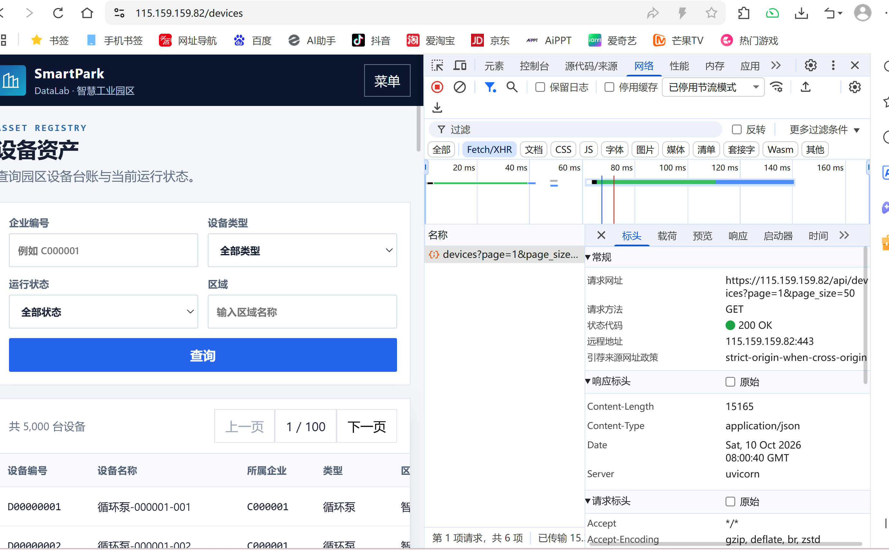
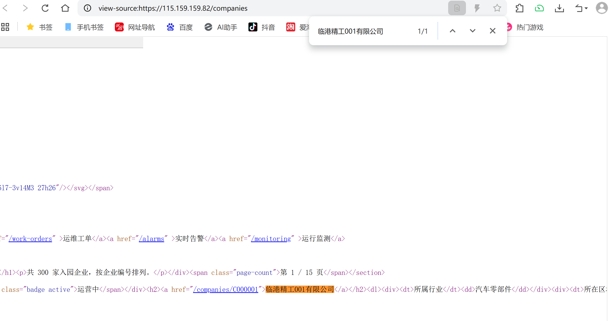
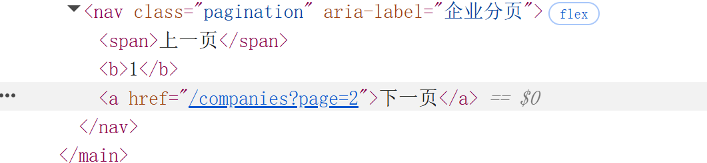
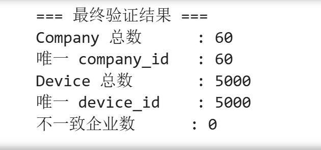

# Lab 1 实验报告

## 学生信息

- **姓名：** 江佩泽
- **学号：** 112404260102
- **班级：** 数据1241班
- **GitHub 用户名：** （待填写）
- **仓库地址：** （待填写，形如 https://github.com/用户名/bigdata-collection-labs-112404260102 ）

> 文件位置：`lab01/REPORT.md`  
> 完整代码保存在 `lab1_html_api.ipynb`。  
> 本报告只填写关键发现、关键代码、结果和指定截图，**不要把整份 Notebook 复制进来**。

---

# 任务 1：判断数据加载方式

## 1.1 Device：判断动态加载并找到 API

### 判断结果

- 页面：`/devices`
- 数据加载方式：`动态加载`
- 判断依据：

在 `/devices` 页面右键 → 查看网页源代码，按 `Ctrl + F` 搜索页面上真实显示的设备名称（例如 `循环泵-000001-001`），**源代码中搜不到**，说明设备数据不是随初始 HTML 一起返回的。随后打开 F12 → Network → Fetch/XHR 并刷新页面，找到了一个返回设备列表的请求 `GET https://115.159.159.82/api/devices?page=1&page_size=50`，说明设备数据由该 API 动态加载。

### API 信息

- Request URL：`https://115.159.159.82/api/devices`
- Request Method：`GET`
- Query 参数：`page`（当前页）、`page_size`（每页条数）；另有可选筛选参数 `company_id`、`device_type`、`status`、`zone`

### 【截图 1】Device API 发现证据

文件名：

```text
images/01_device_api.png
```

**截图内容必须是浏览器 DevTools，不是 Jupyter 代码。**

截图中应能看清：

1. 浏览器的 **Network** 面板；
2. 已选中真正返回设备列表的 Fetch/XHR 请求（`devices`）；
3. 右侧 **Headers** 中的 Request URL；
4. Query String Parameters（`page`、`page_size`）。

> 不要截整个桌面；尽量裁剪到 Network 请求和右侧 Headers 区域。

插入：

```markdown

```

---

## 1.2 Company：判断静态加载

- 页面：`/companies`
- 数据加载方式：`静态加载`
- 判断依据：

在 `/companies` 页面右键 → 查看网页源代码，按 `Ctrl + F` 搜索页面上真实显示的企业名称（例如 `临港精工001有限公司`），**能在源代码中直接搜到**该企业名称及其对应的 `<article class="company-card">` 记录，说明企业数据已经包含在服务器返回的 HTML 里，属于静态加载，可以直接用 `requests` + BeautifulSoup 解析。

### 【截图 2】Company 静态加载证据

文件名：

```text
images/02_company_source.png
```

**截图内容必须是“查看网页源代码”页面，不是 Elements，也不是 Jupyter。**

截图中应能看清：

1. 浏览器正在显示 `/companies` 的网页源代码；
2. 使用 `Ctrl + F` 搜索一个页面中真实存在的企业名称（如 `临港精工001有限公司`）；
3. 源代码中能看到该企业名称或对应企业记录。

插入：

```markdown

```

---

# 任务 2：Device API 分页采集

## 2.1 API 分页结构

填写你实际从 JSON 中观察到的字段：

| 含义 | JSON 字段 |
|---|---|
| 当前页 | `page` |
| 每页条数 | `page_size` |
| 设备总数 | `total` |
| 设备列表 | `items` |

---

## 2.2 关键代码

只填写分页采集的核心部分，不要粘贴整个 Notebook。

```python
# 从第一页响应中读取分页信息
total = data["total"]
page_size = data["page_size"]

total_pages = (total + page_size - 1) // page_size

devices = []

for page in range(1, total_pages + 1):
    r = requests.get(
        api_url,
        params={
            "page": page,
            "page_size": page_size
        },
        timeout=10
    )

    page_data = r.json()
    page_items = page_data["items"]
    devices.extend(page_items)
```

---

## 2.3 采集结果

- 每页条数：50
- 设备总数：5000
- 程序计算得到的总页数：100
- 最终采集设备数：5000
- 唯一 `device_id` 数：5000

回答：

> 为什么总页数应由 API 返回的 `total` 和 `page_size` 计算，而不是直接在代码里写死？

答：

因为 `total` 和 `page_size` 是服务器当前真实返回的分页信息，写死页数等于把“数据有 5000 条、每页 50 条”这个会变化的假设固定进代码。一旦平台新增或删除设备，或者把 `page_size` 改掉，写死的页数就会导致少采（漏数据）或多采（请求空页、拿到空列表）。用 `(total + page_size - 1) // page_size` 算出向上取整的页数，代码会随着数据量自动适应，不需要改一行。

---

# 任务 3：Company HTML 解析

## 3.1 企业记录 Selector

- 企业记录 selector：`article.company-card`
- 第 1 页企业记录数：20

说明为什么选择这个 selector：

- 主要使用了 `id / class / data-* / 父子层级` 中的哪一种？

主要使用了 **class**（`company-card`，语义明确、只用来说明“这是一条企业记录”），另外用 **data-\*** 属性 `data-company-id` 取企业编号，没有依赖父子层级。

- 是否参考过浏览器 Copy selector 或 AI？

参考过浏览器 Copy selector，但得到的是一条带多个 `nth-child(...)` 的深层路径。

- 最终为什么采用现在这个写法？

`article.company-card` 只有一层、语义明确，而且对页面结构变化不敏感：新增或调整企业卡片内部元素不会影响它。相反，Copy selector 那种 `nth-child(...)` 路径只要中间少一个节点就整体失效。按“先找 id → 再找稳定 class → 再看 data-* → 最后才用层级”的顺序，这里最合适的就是 class 这一层。

---

## 3.2 关键代码

只填写“记录定位 + 一条记录的关键字段”。

```python
cards = soup.select("article.company-card")

card = cards[0]

company_id = card.get("data-company-id")
name = card.select_one("h2 a").get_text(strip=True)
status = card.select_one(".badge").get_text(strip=True)
```

行业、区域、设备数量使用 `dt/dd` 结构后，请写出你最终如何得到：

```python
details = {}
for item in card.select("dl > div"):
    key = item.select_one("dt").get_text(strip=True)
    value = item.select_one("dd").get_text(strip=True)
    details[key] = value

industry = details["所属行业"]
zone = details["所在区域"]
device_count = int(details["设备数量"].replace("台", "").strip())
```

---

## 3.3 字段来源说明

任选 **2 个字段**说明：

1. 字段：`company_id`
   - 来自：`HTML 属性`
   - 使用的方法：`card.get("data-company-id")`，直接读取企业卡片最外层 `<article>` 上的 `data-company-id` 属性值，如 `C000001`。

2. 字段：`name`
   - 来自：`文本`
   - 使用的方法：`card.select_one("h2 a").get_text(strip=True)`，先在当前卡片内部定位标题里的 `<a>` 节点，再取它的文本并去掉首尾空白，如 `临港精工001有限公司`。

---

# 任务 4：Company “下一页”分页

## 4.1 下一页元素

- “下一页” selector：`nav.pagination a:last-of-type`
- 第 1 页 `href` 示例：`/companies?page=2`

> 说明：分页区里第 1 页的“上一页”是 `<span>`，从第 2 页开始才变成 `<a>`。所以不能直接写 `nav.pagination a`（第 2 页会选中“上一页”），用 `a:last-of-type` 取分页区最后一个链接（即“下一页”）才稳定。

### 【截图 3】Company “下一页”元素

文件名：

```text
images/03_company_next.png
```

**截图内容必须是浏览器 DevTools 的 Elements 面板。**

截图中应能看清：

1. 页面底部“下一页”对应的 `<a>` 元素被选中；
2. 该元素的 `class`、`href` 等关键属性；
3. 能判断你为什么使用当前 selector。

> 不需要截 Python 代码；这一张图只证明你找到了正确的 DOM 元素。

插入：

```markdown

```

---

## 4.2 关键代码

```python
next_link = soup.select_one("nav.pagination a:last-of-type")

next_href = next_link.get("href")

next_url = urljoin(
    current_url,
    next_href
)
```

再用 2～3 句话说明：

> 你的程序如何完成“当前页 → 找下一页 href → 请求下一页 → 再解析”的循环？

答：

用一个 `for` 循环重复 3 轮：每轮先用 `requests` 请求 `current_url` 并用 BeautifulSoup 解析出本页 20 条企业，再用 `nav.pagination a:last-of-type` 找到“下一页”链接并读出它的 `href`。因为 `href` 是相对路径（`/companies?page=2`），要用 `urljoin(current_url, next_href)` 拼成完整地址，然后把它赋值给 `current_url`，下一轮循环就会去请求这一页，如此一页一页往下走，直到采满 3 页。

---

## 4.3 三页采集结果

| 页码 | 企业数 |
|---|---:|
| 1 | 20 |
| 2 | 20 |
| 3 | 20 |
| **合计** | 60 |

- 唯一 `company_id` 数：60

---

# 任务 5：结果验证

## 5.1 最终结果

| 检查项 | 结果 |
|---|---:|
| Company 总数 | 60 |
| 唯一 `company_id` | 60 |
| Device 总数 | 5000 |
| 唯一 `device_id` | 5000 |
| Company–Device 不一致企业数 | 0 |

### 【截图 4】最终验证结果

文件名：

```text
images/04_validation.png
```

**截图内容必须是 JupyterLab 的运行结果，不是代码截图，也不是浏览器截图。**

截图中应能同时看清以下输出：

```text
Company 总数
唯一 company_id 数
Device 总数
唯一 device_id 数
Company–Device 不一致企业数
```

> 已把这几个 `print()` 放在 Notebook 的同一个单元格中，运行后截图即可。

插入：

```markdown

```

---

## 5.2 一致性检查关键代码

只填写最关键的比较逻辑：

```python
from collections import Counter

device_counts = Counter(
    x["company_id"] for x in devices
)

mismatch_count = 0

for company in companies:
    cid = company["company_id"]
    expected = company["device_count"]
    actual = device_counts.get(cid, 0)

    if expected != actual:
        mismatch_count += 1
```

回答：

> 为什么 `status_code == 200` 仍然不能说明“数据已经采集正确”？

答：

`status_code == 200` 只表示服务器成功处理了这次请求并返回了内容，它完全不保证内容是我们想要的。请求参数写错、分页只跑了第一页、解析 selector 匹配不到节点、或者被要求登录却拿到了一个“请登录”的页面，这些情况 HTTP 状态码同样可能是 200。所以必须进一步做实质校验：检查总条数是否等于 5000、`device_id` 与 `company_id` 有没有重复、以及用企业页面的 `device_count` 与设备表里按 `company_id` 统计出的真实条数交叉比对（`mismatch_count` 必须为 0），才能说明数据是真的采对了。

---

# 任务 6：保存采集结果

确认已经生成：

```text
data/companies.json
data/devices.json
```

填写：

- `companies.json`：`已生成`
- `devices.json`：`已生成`

---

# 实验结论

用 **80～150 字**总结：

1. 静态加载与动态加载页面的处理方式有什么不同；
2. HTML “下一页”分页和 API `page` 分页有什么不同；
3. 你使用了哪些方法验证采集结果。

答：

静态页面（Company）的数据随 HTML 一起返回，直接 `requests` 取源码再用 BeautifulSoup 加 CSS Selector 解析；动态页面（Device）源码里没有数据，要先在 Network 里找到 API，再请求 JSON。分页上，API 用 `page`/`page_size` 参数、由 `total` 算出总页数循环请求；HTML 分页则要在每页里找“下一页”链接的 `href`，用 `urljoin` 拼出下一页地址再继续爬。验证方面，我检查了总条数、`id` 唯一性，并用企业页面的 `device_count` 与设备表统计结果交叉比对，不一致为 0。
