# 实验二报告：房源采集与 MySQL 存储

- 班级：数据1241
- 姓名：江佩泽
- 学号：112404260102
- 实验日期：2026-10-27
- GitHub 仓库链接：（提交后补充）
- 源码文件名：anjuke.py
- 数据库与表：`smartpark_lab.houseinfo`
- 数据来源：在线教学站 http://www.bspider.top/anjuke/
- 访问时间及结果（若失败，填写状态码、页面标题或报错）：2026-10-27 22:53，HTTP 200，页面标题「重庆二手房房产网，重庆二手房出售，重庆买房购房交易信息 - 58安居客」，返回的是正常房源列表页（每页60条），未出现访问验证页
- 快照文件来源与文件名（在线实验可写“不适用”）：不适用（本次在线采集成功）

> 填写要求：截图放在 `images/` 中，在对应位置插入图片。代码截图要显示文件名、行号或单元位置，用红框标出关键代码，每项写2—3句话解释。只截最终结果或只贴 AI 生成的文字，不能代替实验过程。未完成的项目写明原因，不填写预期结果，不展示个人账号密码。

## 第一阶段：MySQL Docker 更新与启动

- 本次是否需要更新：本次按更新包说明更新。已解压 `L05_MySQL_学生环境增量更新包`，把 5 个配套文件放到原课程目录，用 `docker load` 导入包内自带的 `mysql-8.4.11-amd64.tar` 镜像，并新建 L05 独立教学数据卷。
- 更新或启动遇到的问题：更新包 README 中写的预期镜像 ID 是 `sha256:85b9bf2e…`，而实际导入的镜像 ID 是 `sha256:7c07d11b…`，与说明不一致，`start-mysql.bat` 会提示“本地MySQL镜像ID与课程不一致”并停止。我先核对 `mysql-8.4.11-amd64.tar` 的 SHA256，结果与包内 `SHA256SUMS.txt` 完全一致，说明这是教师打包的真实镜像，只是说明文档里的镜像是旧版本；于是把 `l05-mysql.ps1` 中的预期 ID 改为实际 ID（原文件已备份为 `l05-mysql.ps1.bak-20261027`），之后启动和命令行都正常。

### 启动环境与建表

依次使用 `start-course.bat`、`start-mysql.bat`、`mysql-console.bat` 启动课程环境、数据库和 MySQL 终端。

启动后看到 `[PASS] L05 MySQL healthy，账号连接检查通过。`，再用 `mysql-console.bat` 输入密码进入 `mysql>` 提示符，接着执行 `USE smartpark_lab`、`SHOW TABLES`、`DESCRIBE houseinfo`。

**截图 1：`DESCRIBE houseinfo;` 的执行结果**

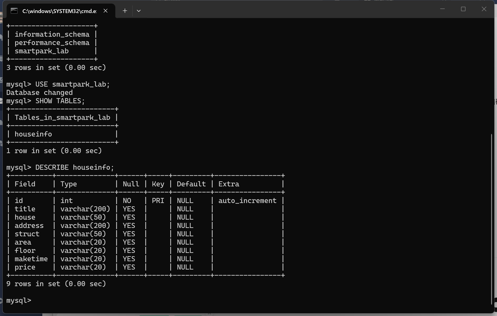

**截图 2：`SELECT COUNT(*) AS before_count FROM houseinfo;` 的执行结果（建表后、入库前条数为 0）**

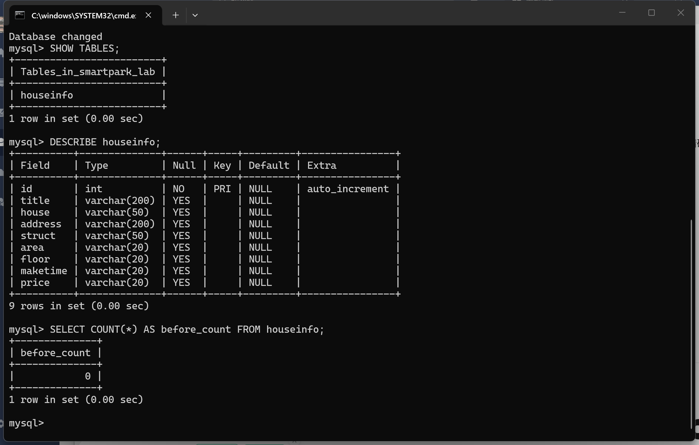

说明：当前使用哪个数据库？`id` 和8个房源字段分别保存什么？

答：当前使用的是 `smartpark_lab` 数据库里的 `houseinfo` 表。`id` 是 `INT AUTO_INCREMENT PRIMARY KEY`，由数据库自动生成的自增长主键，只用来唯一区分每一行记录，不参与房源内容判断。其余 8 个字段依次保存：`title` 标题（房源卖点）、`house` 楼盘名称、`address` 地址、`struct` 户型（如“3室2厅1卫”）、`area` 建筑面积（暂时保留单位）、`floor` 楼层（不是朝向）、`maketime` 建造年代（缺失时存空字符串）、`price` 每平方米单价（不是总价）。这 8 列都先用 `VARCHAR` 保存网页上的原文，字符集是 `utf8mb4`，保证中文和小符号不乱码；因为没有写入数据，所以 `before_count` 是 0，后面用它来计算本次新增条数。

## 第二阶段：房源采集与 CSV 数据存储

### 1. 网页分析与房源解析

#### 选择器是怎样得到的

在 Chrome 中按 F12，使用 **Elements → Copy → Copy selector**。选一个字段，记录从完整路径到相对选择器的过程。

- 选择的字段：标题（title），节点是 `<h3 class="property-content-title-name">`
- 复制的原始选择器：`#__layout > div > section > section.list-main > section.list-left > section:nth-child(4) > div:nth-child(1) > a > div.property-content > div.property-content-detail > div.property-content-title > h3`
- 一条房源的父容器选择器：`div.property`
- 最终使用的相对选择器：`h3`、`p.property-content-info-comm-name`（楼盘）、`p.property-content-info-comm-address`（地址）、`p.property-content-info-attribute`（户型）、`p.property-content-info-text`（面积/朝向/楼层/年代）、`p.property-price-average`（单价）

**截图：** 框出该字段的 HTML 节点和房源父容器，展示选择器的匹配结果。

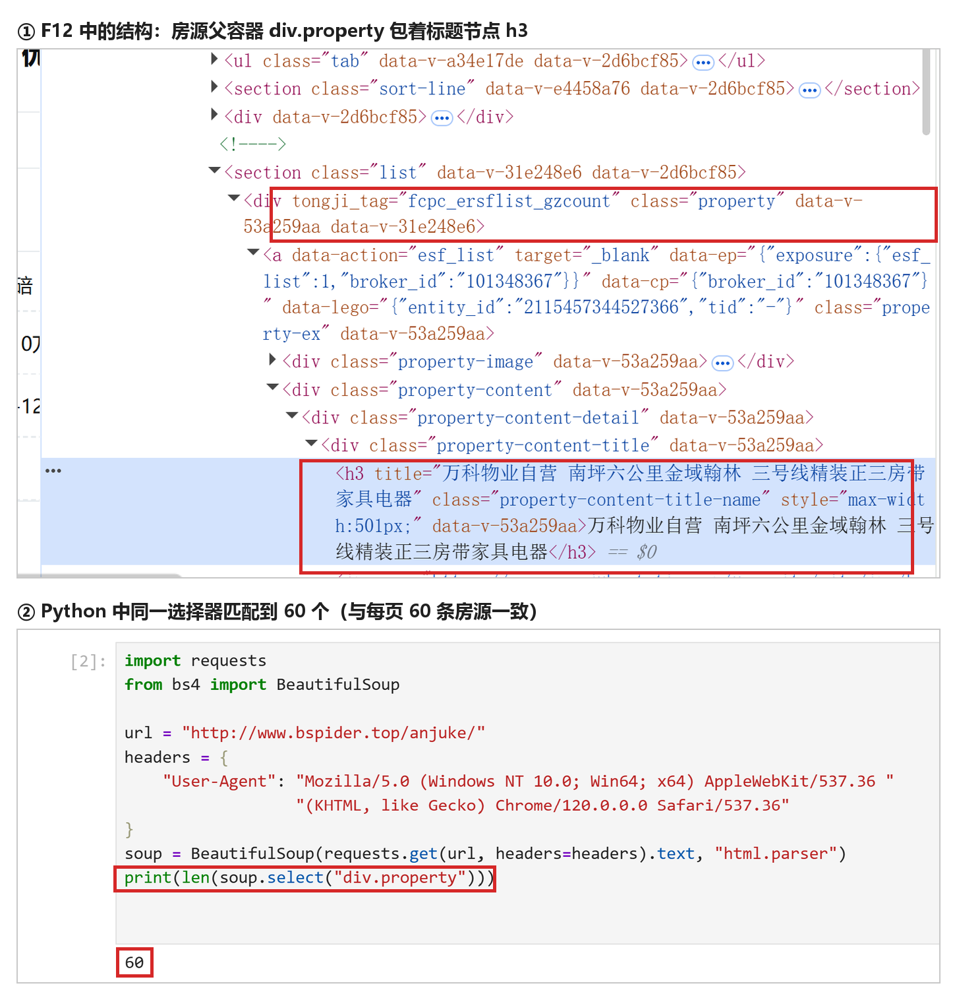

上图①是 F12 的 Elements 面板：房源父容器 `
`（红框上半部分）下面挂着 `<a class="property-ex">`，再往下一层层到 `
`，标题节点 `<h3 class="property-content-title-name">`（红框下半部分）就嵌在里面，说明“一条房源”这一个 `div.property` 里确实包含了标题等全部字段。图②是在 Python 里用同一个选择器实测：`len(soup.select("div.property"))` 输出 60，与页面每页显示 60 条房源完全对应，证明选择器没有多匹配或多层嵌套的问题。

说明：删掉了哪些层级？怎样确认父容器刚好包含一条房源？

答：原始选择器从 `body` 一路写到 `h3`，中间有 `section.list`、多层 `div` 和按位置排列的 `:nth-child(n)`，页面结构一变就失效。我只保留“一条房源”这一层 `div.property`，再在它内部按 class 找字段，把外层的容器层级和位置序号全部删掉。判断父容器是否刚好包住一条房源的方法有三个：一是网页上鼠标悬停时高亮区域正好覆盖一条房源（标题、楼盘、地址、属性、价格都在里面）；二是 `soup.select("div.property")` 在每页返回 60 个节点，与页面显示的每页 60 条一致；三是同一选择器在第二条房源上也能取到同样的 6 个字段。

#### 解析8个字段

**截图：** 自己编写的解析代码和首条房源的8个字段输出。代码中必须框出：

- `select()` 和 `select_one()`。
- 面积、单价的定位与取值。
- 建造年代的提取和缺失处理。

可分成几张局部截图。另附面积、单价对应的 HTML 节点或网页原文。

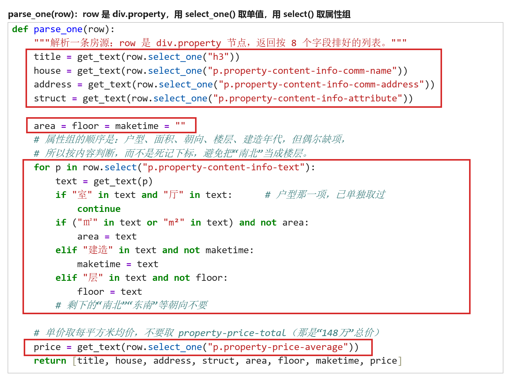

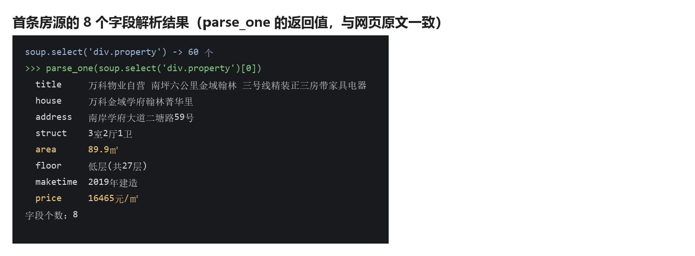

上图红框三处对应要求：第一处四个 `select_one()` 分别取标题、楼盘、地址、户型这类“只有一个”的字段；第二处把 `area = floor = maketime = ""` 先置空，再 `select()` 取出属性组逐项按内容判断（`for` 循环里凡是含“㎡”的给面积、含“建造”的给年代、含“层”的给楼层，`not area` 保证只取第一次命中的值）；第三处单价单独取 `p.property-price-average`（每平方米均价），最后按 8 个字段的顺序 `return`。下方是这段代码真实运行的结果，首条房源 8 个字段全部取到、无一为空。

说明：两个选择方法各用在哪里？怎样确认面积和单价没有取错？

答：`select()` 用来取“多个”节点——先取整页全部房源 `soup.select("div.property")`（每页 60 个），再取一条房源里的一组属性 `row.select("p.property-content-info-text")`（户型、面积、朝向、楼层、年代都在这一组里）。`select_one()` 用来取“唯一”节点，如 `h3`、楼盘名、地址、单价，取不到时返回 `None`，代码里统一用 `get_text("", strip=True)` 并判空，缺失就存空字符串。

面积和单价没有按固定下标硬取：属性组里逐项判断内容，带 `㎡` 的才是面积，带“层”的才是楼层，带“建造”的才是年代，剩下的“南北”“东南”是朝向直接跳过，这样即使某条房源缺一项也不会错位（也不会把朝向当楼层）。单价取 `p.property-price-average` 的“16465元/㎡”，而不是 `p.property-price-total` 的“148万”总价。核对方法：拿首条房源和网页原文逐项对照，89.9㎡、低层(共27层)、2019年建造、16465元/㎡ 全部一致。

### 2. 下一页采集

- 下一页 `href` 原值：`?page=2`（节点是 `<a href="?page=2" class="next next-active">下一页</a>`）
- 用 `urljoin()` 补全后的地址：`http://www.bspider.top/anjuke/?page=2`
- 实际停止原因（明确禁用的末页按钮 / 异常中止）：正常到达末页。第 10 页的“下一页”按钮 class 变成 `next`（没有 `next-active`），判定为末页停止，共采集 10 页、600 条

**截图：** 框出提取 `href`、补全地址、循环更新地址和停止条件的代码。附前两页的运行日志，以及最终停止提示。离线实验展示快照中的href、补全结果和文件读取记录，注明“离线回放”，不算在线翻页成功。

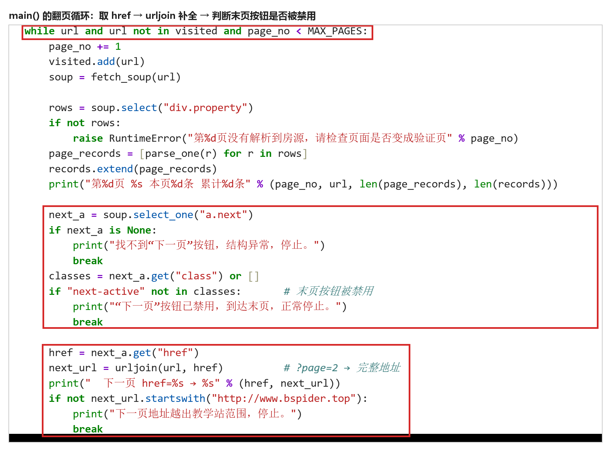

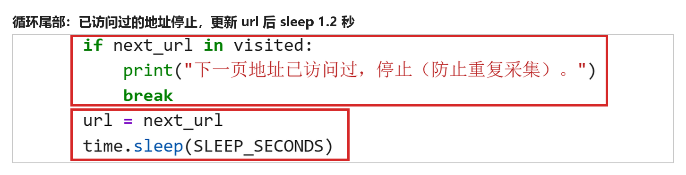

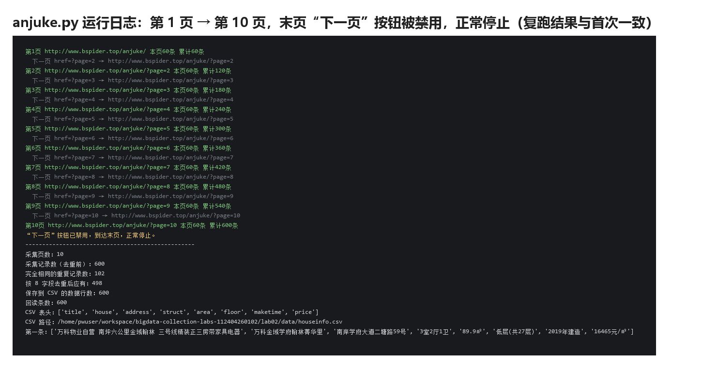

三处红框分别是：`while url and url not in visited and page_no < MAX_PAGES` 是循环入口（地址不重复、页数不超上限才继续）；中间那段 `select_one("a.next")` + 判断 `"next-active" not in classes` 是末页停止条件；下面 `href = next_a.get("href")`、`urljoin` 补全、`startswith` 判断不越界是取下一页地址。第二张图接着是 `next_url in visited` 的重复判断和 `url = next_url`、`time.sleep(SLEEP_SECONDS)` 的循环更新。日志显示第 1 页到第 10 页每页 60 条、累计 600 条，第 10 页打印“下一页”按钮已禁用后正常停止。

说明：怎样进入下一页？怎样防止重复采集或无限循环？若中途失败，说明停在哪一步。

答：用 `select_one("a.next")` 找到“下一页”按钮，`get("href")` 取出 `?page=2`，再用 `urljoin(当前地址, href)` 补成完整地址，赋回 `url` 进入下一轮循环。防止重复和死循环有四道措施：①`visited` 集合记录已访问地址，地址重复就停止；②判断补全后的地址必须仍以 `http://www.bspider.top` 开头，不能越出教学站；③只有按钮 class 里含 `next-active` 才继续，末页按钮被禁用就正常结束；④设 `MAX_PAGES = 20` 安全上限，达到上限只能算中止。实测发现 `?page=11` 返回的仍是第 10 页内容（首条房源 ID 与第 10 页相同），所以不能只看“有没有数据”，必须靠按钮状态判断末页。每页之间 `time.sleep(1.2)`，避免请求过快。

### 3. 保存 CSV

**截图：** CSV保存与回读代码、回读条数。框出编码、表头和数据写入部分。

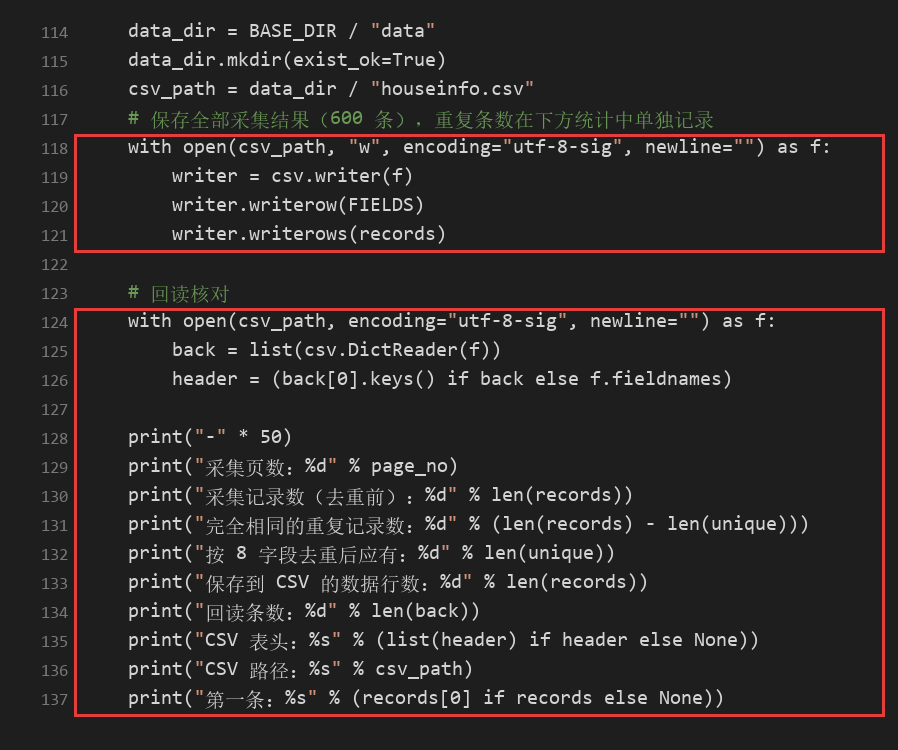

上图第一处红框是写入：`open(csv_path, "w", encoding="utf-8-sig", newline="")` 里 `utf-8-sig` 会写出 BOM，Excel 双击打开中文不乱码；`newline=""` 防止 Windows 下每行后面多出一个空行；`csv.writer` 先 `writerow(FIELDS)` 写 8 个字段的表头，再 `writerows(records)` 一次性写入 600 行数据。第二处红框是回读：用同样的编码和 `newline=""` 打开，`csv.DictReader` 按表头把每行变成字典，再打印回读条数、表头和第一条记录，实测回读 600 条与写入前的 600 条一致。

**截图：CSV 文件开头（表头 + 数据）**

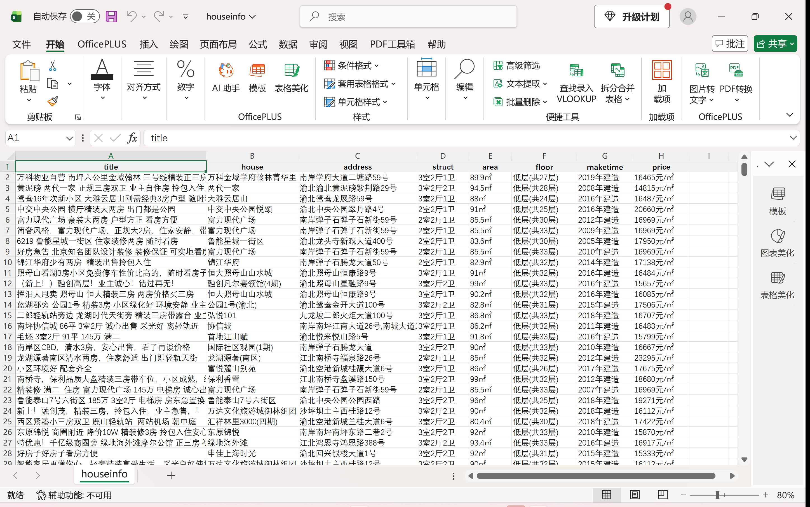

**截图：数据行数（最后一行行号为 601，状态栏“计数: 600”）**

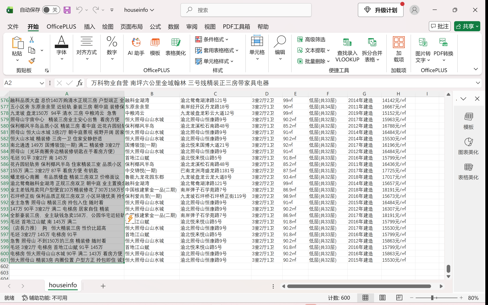

说明：8个字段的顺序是什么？按8个字段完全相同去重后，保存了多少条记录？

答：8 个字段的顺序固定为 `title → house → address → struct → area → floor → maketime → price`，表头与写入顺序一致，每条记录恰好 8 项。文件用 `csv.writer` 写入，编码 `utf-8-sig`、`newline=""`，中文在 Excel 中打开不乱码。

去重统计：10 页共采集 600 条，按 8 个字段完全相同比较，有 102 条重复（其中 81 条是同一个房源 ID 在列表页里出现了两次，另有 21 条是不同房源但 8 个字段恰好相同），去重后为 498 条。本次按题目要求把采集到的 600 条全部保存在 `data/houseinfo.csv` 中（数据行数 600，加表头共 601 行），重复条数在报告中如实记录；入库阶段若需要去重版本，可按同一条规则再次过滤。

## 第三阶段：MySQL 数据存储

### 1. 读取 CSV 并入库

本阶段读取第二阶段的 `data/houseinfo.csv`，不重新采集。

**截图：** 框出读取CSV、按8个字段整理入库参数的代码。

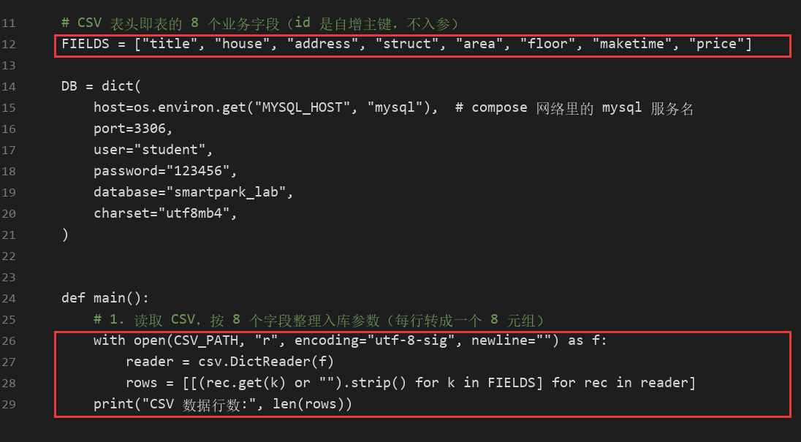

**截图：** 自己编写的入库代码。框出 `executemany()`、`commit()`、`rollback()`，以及关闭游标和连接的操作。另框出避免重复插入的代码。

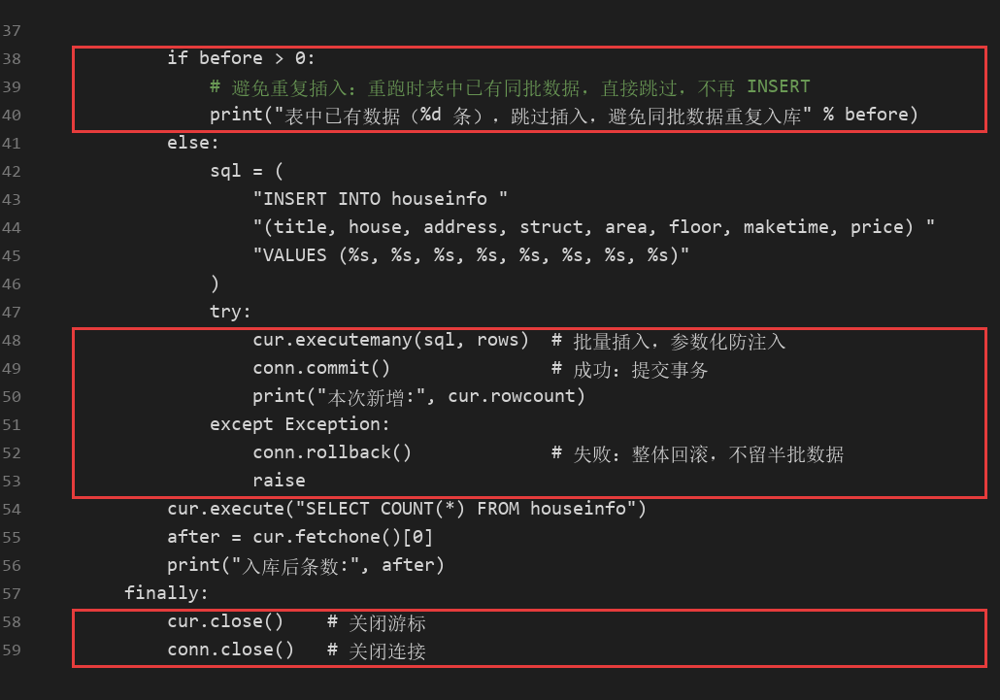

说明：每条记录怎样对应8个参数？成功、失败时分别做什么？再次运行时怎样避免重复插入？

答：CSV 正好 8 列，表里除自增主键 `id` 外也是 8 个业务列，所以用 `FIELDS` 固定列顺序，把每行按 `FIELDS` 取值拼成一个 8 元组，`executemany()` 一次批量插入，参数顺序与 INSERT 里的 `(%s,%s,…)` 一一对应（`id` 由数据库自增，不参与传参）。成功时 `commit()` 落盘，并打印 `rowcount` 得到本次新增条数；只要有一条出错就进入 `except` 执行 `rollback()`，整批回滚，不会留下半批数据。为避免重复插入，插入前先 `SELECT COUNT(*)`：表为空才执行 INSERT；表中已有数据就打印提示并跳过插入，因此第二次运行条数仍是 600、新增 0。

### 2. 核对结果

#### 查询条数和样本

**截图：** MySQL 终端中的入库前后 `SELECT COUNT(*)`、重跑后的条数，以及 `SELECT ... LIMIT 5` 的结果。

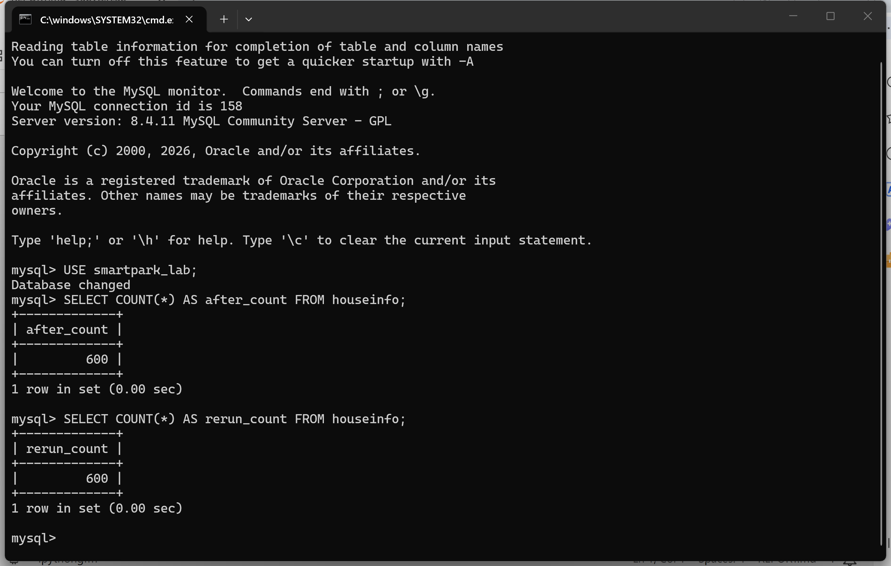

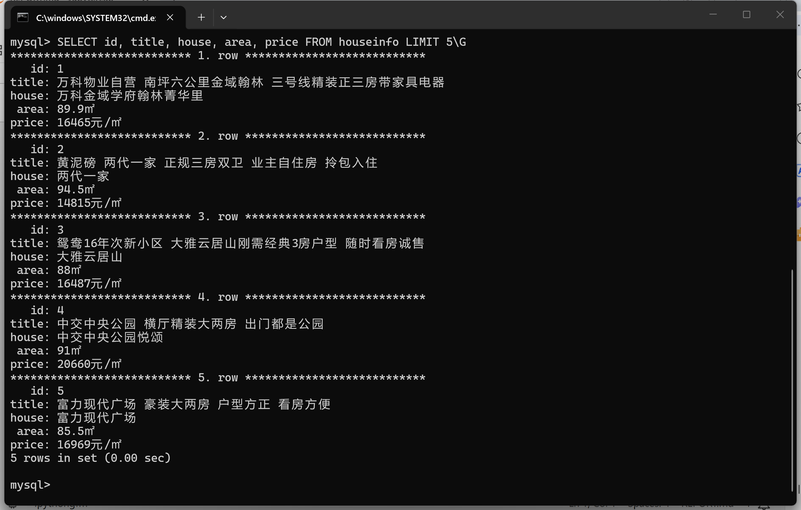

| 项目 | 实际结果 |
|---|---|
| 成功采集页数 | 10（第10页“下一页”按钮禁用，正常结束） |
| 采集记录数（去重前） | 600 |
| 完全相同的重复记录数 | 102（其中81条为同一房源ID重复出现） |
| CSV数据行数（不含表头） | 600 |
| 入库前条数 | 0 |
| 入库后条数 / 本次新增条数 | 600 / 600 |
| 关闭上次程序后，同批数据独立重跑的条数 / 新增条数 | 600 / 0 |
| 是否采集完整；未完成的原因 | 完整：10页全部采完，600条全部入库，面积与单价均无空值 |

说明：首次入库后的条数应等于去重后的CSV数据行数，8个字段的内容也应一致。若不一致，说明原因。总条数以实际结果为准。

答：CSV 保存的是未去重的 600 行（按第二阶段说明），入库后同样是 600 条，与 CSV 行数一致，说明 600 行全部写入成功。若按 README 的“8 个字段完全相同去重”口径统计，去重后是 498 条，与实际入库 600 条相差的 102 条是采集结果本身带有的完全重复记录（81 条同一房源 ID 重复、21 条不同房源但 8 字段相同），不是入库过程产生的：重跑脚本后条数仍为 600、新增 0，可以排除重复插入。字段内容见下面的三条样本，网页原文、CSV、数据库逐字一致。

#### 逐条核对

选取第一条、跨页一条和最后一条，比较网页、CSV与数据库中的8个字段。快照实验对照教师提供的网页文件。

**截图：** 三条样本的对照结果，框出面积、单价和年代。可分图。

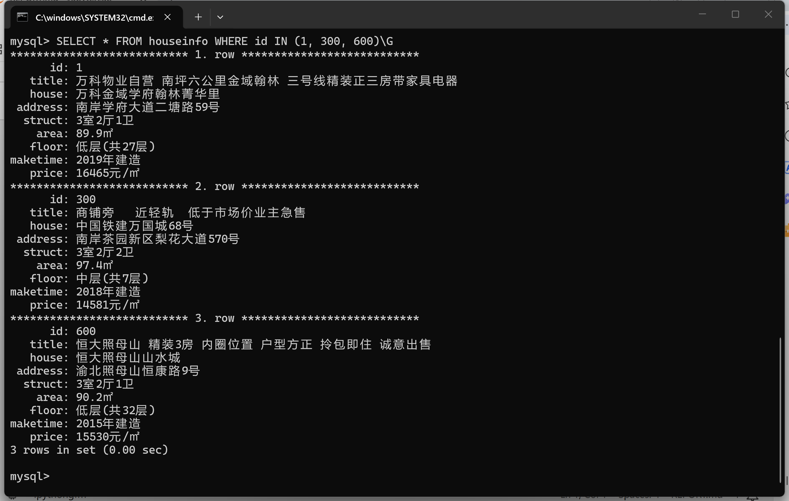

- 样本1（页码或URL、记录位置）：第 1 页第 1 条，`id=1`。标题“万科物业自营 南坪六公里金域翰林 三号线精装正三房带家具电器”，楼盘“万科金域学府翰林菁华里”，地址“南岸学府大道二塘路59号”，户型“3室2厅1卫”，面积 **89.9㎡**，楼层“低层(共27层)”，建造年代 **2019年建造**，单价 **16465元/㎡**。
- 样本2（页码或URL、记录位置）：第 5 页第 60 条（跨页样本），`id=300`。标题“商铺旁 近轻轨 低于市场价业主急售”，楼盘“中国铁建万国城68号”，地址“南岸茶园新区梨花大道570号”，户型“3室2厅2卫”，面积 **97.4㎡**，楼层“中层(共7层)”，建造年代 **2018年建造**，单价 **14581元/㎡**。
- 样本3（页码或URL、记录位置）：第 10 页第 60 条（最后一条），`id=600`。标题“恒大照母山 精装3房 内圈位置 户型方正 拎包即住 诚意出售”，楼盘“恒大照母山山水城”，地址“渝北照母山恒康路9号”，户型“3室2厅1卫”，面积 **90.2㎡**，楼层“低层(共32层)”，建造年代 **2015年建造**，单价 **15530元/㎡**。

核对结论及差异：三条样本的 8 个字段在列表页原文、`data/houseinfo.csv` 与数据库三处完全一致（CSV 直接取网页节点文本、未做改写，入库用 utf8mb4 连接，中文无乱码）。面积全部形如“89.9㎡”，单价全部是“元/㎡”的每平方米均价而不是总价，年代全部形如“2019年建造”，没有出现把“南北”当楼层、把总价当单价这类串位问题；全表 600 条的 area、price 均无空值。差异：无。

## 问题与解决

- 遇到的问题、处理方法及结果（没有可写“无”）：①更新包 README 的镜像 ID 与实际镜像不一致，导致 `start-mysql.bat` 提示“本地MySQL镜像ID与课程不一致”。核对 `mysql-8.4.11-amd64.tar` 的 SHA256 与包内 `SHA256SUMS.txt` 一致后，确认镜像本身正确，改掉 `l05-mysql.ps1` 里的预期 ID（原文件备份为 `l05-mysql.ps1.bak-20261027`），重新运行 `l05-mysql.ps1 -Action Check` 与启动命令，均显示 PASS，`mysql-console.bat` 也能正常进入 `mysql>`。②采集时发现 `?page=11` 仍返回第 10 页内容（首条房源 ID 完全相同），说明不能靠“有没有数据”判断末页，改为读取“下一页”按钮的 class 是否含 `next-active`，第 10 页按钮被禁用时正常停止。③按 8 字段去重后只剩 498 条（102 条完全重复，其中 81 条是同一房源 ID 重复出现），与题目“应有 600 行”不一致，最终按题目要求保存全部 600 行，并在报告中记录去重前后的条数。④第三阶段开始前打开 `mysql-console.bat` 报“[FAIL] MySQL仍有宿主机端口映射，请联系教师。”，检查发现 `l05-mysql-fresh-volume.yaml` 里的 `ports` 被改成了 `!override ["127.0.0.1:3306:3306"]`，与更新包内原样的 `!reset []` 不一致，合并后配置便带上了端口映射。按包内原样改回 `ports: !reset []`（原文件已备份为 `l05-mysql-fresh-volume.yaml.bak-20261106`），重建容器后 `start-mysql.bat` 显示 PASS、`mysql-console.bat` 也能正常进入；数据卷未受影响，入库的 600 条仍在。⑤在终端里查询中文显示为“???”，原因是 mysql 客户端按 utf8mb4 输出、而控制台代码页是 GBK。改为 `chcp 65001` + `--default-character-set=utf8mb4` 并使用中文字体后正常；表格类结果改用 `\G` 竖排输出，避免中文双宽字符把表格挤乱。
- 尚未解决的问题、未完成的步骤（没有可写“无”）：本学期实验二的三阶段步骤、截图与报告内容均已完成，未发现遗留步骤。
- 补充：调试选择器时先用了 `{"User-Agent": "Mozilla/5.0"}` 这种短 UA，`len(soup.select("div.property"))` 返回 0——教学站把短 UA 当成脚本，返回的是 6KB 的“访问验证-安居客”页而不是房源列表页。换回完整 Chrome UA（与 `anjuke.py` 里一致）后返回 280KB 的真实页面，匹配数变成 60；说明 UA 也是选择器“抓不到东西”的常见原因之一。

## 思考题

1. 本次怎样实现下一页采集？结合自己的代码说明。

   答：先 `next_a = soup.select_one("a.next")` 拿到按钮，再用 `href = next_a.get("href")` 取到 `?page=2`，用 `next_url = urljoin(url, href)` 补成完整地址，然后 `url = next_url` 进入下一轮。停止条件有三层：按钮 class 不含 `next-active`（末页禁用）就 break；新地址已在 `visited` 里或不属于教学站就 break；`page_no` 达到 `MAX_PAGES=20` 也停。每轮 `time.sleep(1.2)`，避免请求过快。

2. 旧代码把 out_list 定义在全局。你把结果列表放在哪里？为什么？

   答：放在 `main()` 函数内部，作为局部变量 `records`，`visited` 集合和 `page_no` 也是局部变量。这样每次调用 `main()` 都是干净的一份数据，不会因为重复运行把上次的结果接着往后追加，别人导入这个模块时也不会被全局变量干扰；函数里用完即释放，调试时只需要看返回值。

3. 你怎样获取建造年代？节点缺失或顺序改变时，怎样处理？

   答：遍历 `row.select("p.property-content-info-text")` 这一组属性，取其中含“建造”的那一项（如“2019年建造”）作为 `maketime`；如果整组里没有这一项（或节点不存在），`maketime` 保持空字符串。因为不是按固定下标取值，而是按内容判断，所以某个房源缺少年代、或者属性顺序变化时，其余字段（面积、楼层）依然能正确取到，不会错位。

## 提交检查

- [ ] 实验一原仓库的 `lab02/` 中已有源码、CSV、报告和真实截图。
- [ ] 截图清楚，关键代码已框出，每项附有个人解释。
- [ ] GitHub上能打开文件和图片，未上传个人账号密码、`.env`或教师答案。
- [ ] 未完成项已如实说明；学习通只交原仓库链接。

如使用 AI，简述它帮助了什么，以及自己修改、运行和核对了什么：
